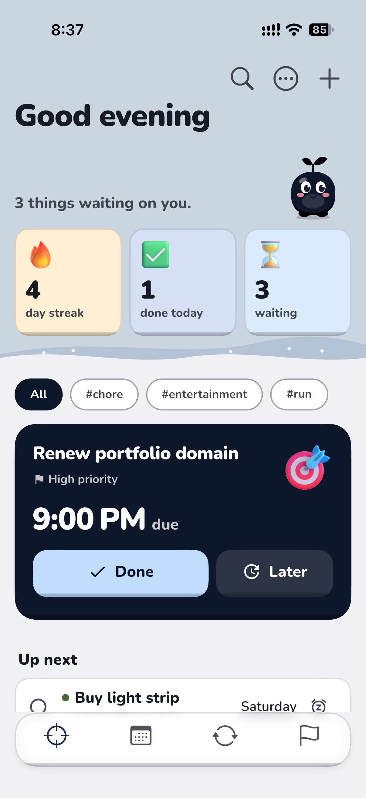
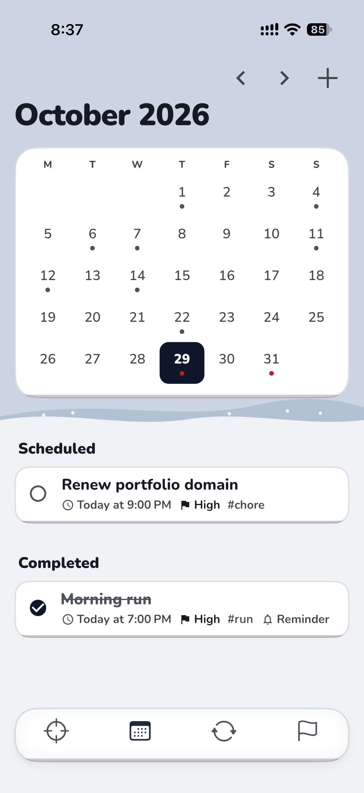
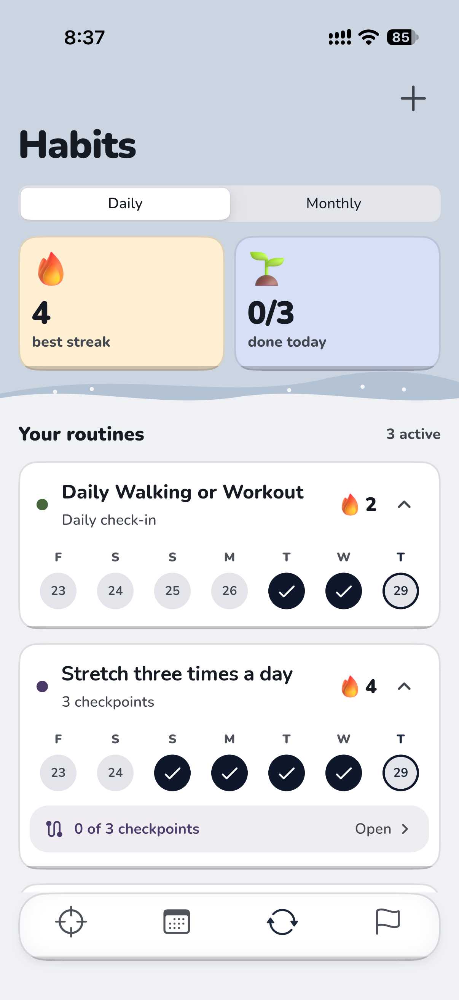
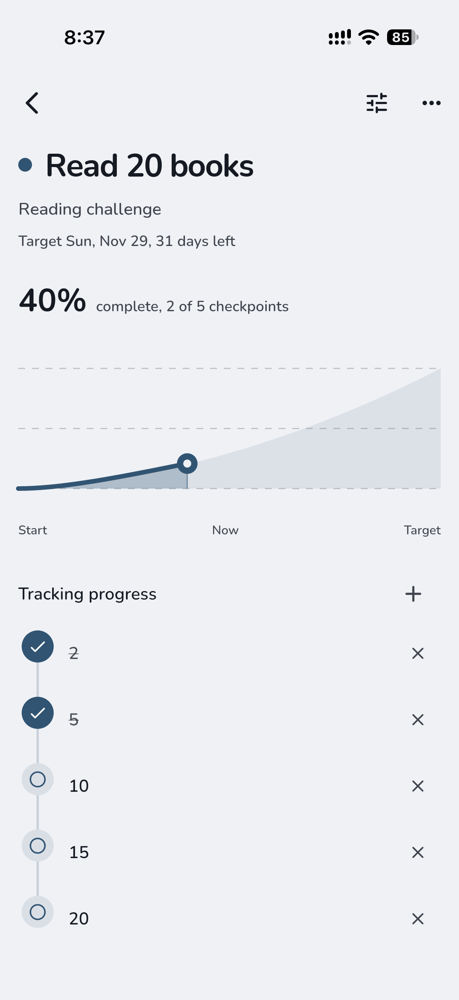
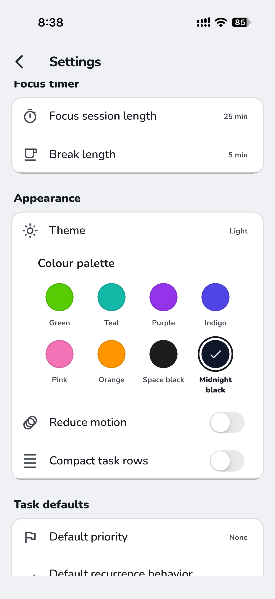

# Nudge

A bright, local-first task manager for Android and iOS. The central promise:
**important tasks remain visible and continue reminding you until they are
handled.** No accounts, no backend, no analytics; everything stays on the
device.

## Screenshots

The data in these screenshots is demonstration data.

<p align="center">
  
  
  
</p>
<p align="center">
  
  
</p>

## Features

Four tabs: **Focus**, **Calendar**, **Habits** and **Goals**. Completed
tasks and Settings open from the Focus menu.

- **Focus** — a greeting with a day streak, done-today and waiting count;
  `#tag` filters; one spotlight task with **Done** and **Later**; then
  overdue, today and up-next lists. Swipe a row to defer it ("not today").
- **Escalation** — tasks that keep being put off (snoozed, deferred or left
  overdue) climb back into the spotlight, show a "Put off N times" marker, and
  get a daily "still waiting" nudge once their reminders have fired.
- **Quick add** — title plus optional deadline in seconds; understands natural
  language ("call mom tomorrow 5pm", "report friday", "in 3 days") and
  `#tags`. The full editor is one tap away.
- **Task editor** — subtasks (reorder, collapse completed), recurrence,
  multiple reminders, opt-in persistent alarms, rich-text details, a colour
  swatch, and autosave.
- **Recurring tasks** — fixed schedule or repeat-after-completion, presets and
  custom rules (intervals, weekdays, day of month or last day, end date or
  count). Only one occurrence is active at a time; future ones are projected
  on the calendar.
- **Calendar** — month grid with dots for busy days, plus that day's
  scheduled and completed tasks.
- **Habits** — daily or monthly routines, as a simple check-in or a timer.
  Optional checkpoints (all done marks the day done), streaks, a week strip
  of check-ins, and their own reminders.
- **Goals** — target date, checkpoints or a manual percentage, and a progress
  chart from start to target.
- **Focus timer** — Pomodoro with configurable focus and break lengths; time
  spent is credited to the task, and the session-end alert fires even in the
  background.
- **Search** — titles, rich-text details, subtasks and tags, including
  completed history.
- **Notifications** — reminders and opt-in persistent alarms with cadence,
  quiet hours (reminders shift, never drop), snooze, and Complete/Snooze
  actions on the notification. Permission is requested only when you turn on
  your first reminder.
- **Completed** — grouped by completion date; restore, delete, or clear, with
  a "keep completed tasks" retention setting.
- **Home-screen widgets** — "Up next" (the single most important task) and a
  task list matching Focus, with deep links into the app. On Android, each
  task also has a complete button, and widgets can be pinned from Settings.
- **Look** — eight colour palettes (Green, Teal, Purple, Indigo, Pink, Orange,
  Space black, Midnight black), light, dark or system theme, a mascot, Reduce
  Motion and compact rows. On iOS the app icon and widgets follow the palette.
- **Your data** — JSON export/import of tasks, habits and goals; `.ics` export
  of open tasks; "Add to device calendar" per task (one-way, no permissions);
  delete all local data.

## Install

Builds are on the [Releases](../../releases) page. Each release lists SHA-256
checksums; check the download with `shasum -a 256 <file>` (macOS/Linux) or
`certutil -hashfile <file> SHA256` (Windows).

### Android (APK)

1. Download `app-release.apk` on the phone.
2. Open it. When asked, allow your browser or file manager to install unknown
   apps.
3. Tap **Install**.

If Android says the app conflicts with an existing package, the new APK is
signed with a different key. Export your data first (Settings → Export data
as JSON), uninstall the old app, install the new one, then import.

### iOS (unsigned IPA, sideloaded)

The `.ipa` is unsigned, so iOS won't install it directly; a sideloading tool
signs it with your own Apple ID.

1. Install [AltStore](https://altstore.io) or
   [Sideloadly](https://sideloadly.io) on your computer.
2. Connect the iPhone, then sideload `Nudge.ipa` with your Apple ID.
3. On the iPhone, trust your developer profile in Settings → General → VPN &
   Device Management, and turn on Developer Mode (Settings → Privacy &
   Security) if asked.

With a free Apple ID the app expires after 7 days; re-sideload (or refresh in
AltStore) to keep it, and your data stays. Free accounts also allow only 3
sideloaded apps at once. Home-screen widgets need the tool to keep the App
Group (`group.com.abrar118.nudge`); if they show no tasks, the app still
works without them.

## Architecture

```
lib/
  core/        theme, palettes, colours, typography, date formatting
  domain/
    models/    Task, Habit, Goal, RecurrenceRule, reminders, Swatch, DateOnly
    logic/     RecurrenceEngine, NotificationPlanner, FocusArranger,
               QuietHours, TaskMutations, QuickAddParser, TaskSearch,
               Escalation   (pure Dart, unit tested)
  data/        sqflite task repository, settings/habits/goals
               (shared_preferences), JSON and .ics codecs
  services/    notifications, habit reminders, home-screen widgets,
               app icon, background action handlers
  state/       AppState, SettingsController, HabitController,
               GoalController, FocusTimerController
  ui/          screens and shared widgets
```

Deadlines are stored as calendar dates plus optional minutes-of-day, which
makes recurrence math immune to daylight-saving and time-zone changes.
Notification scheduling syncs by replacing the full plan (cancel all +
reschedule), so schedules can never duplicate or orphan.

## Development

```sh
flutter pub get
flutter test
flutter run          # on an Android or iOS device/simulator
```

## License

Licensed under the [Apache License 2.0](LICENSE).
